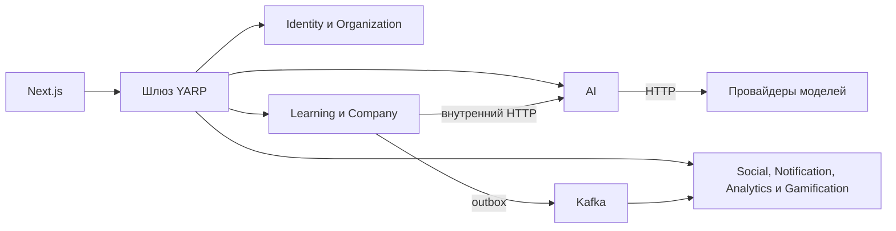

# Архитектура

Браузер обращается к шлюзу YARP. Шлюз проверяет JWT, очищает переданные клиентом заголовки идентификации и передаёт доверенный контекст сервису. Сервис проверяет полномочия и доступ к конкретному ресурсу. Внутренние запросы с межсервисным ключом имеют отдельные маршруты.

| Сервис | Ответственность |
| --- | --- |
| Identity | Учётные записи, JWT, аватары, приглашения, членство, impersonation |
| Organization | Реестр, профиль организации, заявления на демо и выдача доступа |
| Learning | Навыки, темы, упражнения, версии контента, назначения, результаты |
| Company | Карточки компаний, контакты, этапы сделки, журнал и напоминания |
| AI | Диалоги, оценка ответов, распознавание и синтез речи, учёт расходов |
| Social | Друзья, сообщения, обсуждения, вложения |
| Gamification | Баллы, серии, достижения и агрегаты прогресса |
| Notification | Входящие уведомления, пользовательские предпочтения, доставка |
| Analytics | Приём продуктовых событий, агрегация метрик |
| Gateway | Маршрутизация, проверка токена, передача контекста |

Внутри сервиса предметные области находятся в `Features/`, внешние операции и хранение — в `Infrastructure/`. HTTP-контроллер проверяет вход и вызывает сценарий. Контракты сценария содержат типы предметной области. В новых сценариях транзакцию задаёт сценарий через контракт, реализация работает с контекстом EF. В сложившемся коде часть сценариев использует DbContext напрямую. Конкретные реализации собираются в точке запуска. Единственная разрешённая общая проектная зависимость сервисов — `building-blocks`.

Для событий, которые должны пережить сбой публикации, изменение данных и запись в outbox фиксируются одной транзакцией. Потребители получают контекст организации из конверта сообщения. Границы владения данными и правила фонового чтения описаны в [изоляции организаций](operations/tenancy.md) и [реестре задач](operations/jobs.md).
