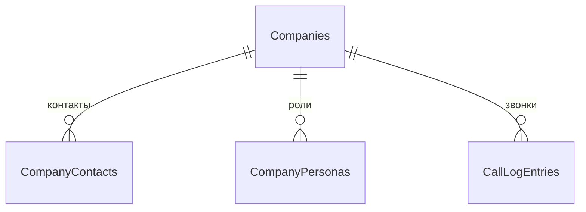

# Схема данных

Каждая реляционная модель принадлежит одному сервису. EF Core задаёт таблицы, первичные и внешние ключи, уникальные ограничения и индексы. По ссылкам приведены DDL, полученные из текущих DbContext. Миграции дополнительно содержат политики RLS, перенос данных и служебные операции.

| База | Таблиц в модели | Модель и миграции | Таблицы, поля, связи и индексы |
| --- | ---: | --- | --- |
| ai | 6 | [EF Core](../backend/ai-service/Ai/Infrastructure/Data) | [DDL](contracts/database/ai.sql) |
| company | 5 | [EF Core](../backend/company-service/Company/Infrastructure/Data) | [DDL](contracts/database/company.sql) |
| gamification | 14 | [EF Core](../backend/gamification-service/Gamification/Infrastructure/Data) | [DDL](contracts/database/gamification.sql) |
| identity | 11 | [EF Core](../backend/identity-service/Identity/Infrastructure/Data) | [DDL](contracts/database/identity.sql) |
| learning | 30 | [EF Core](../backend/learning-service/Learning/Infrastructure/Data) | [DDL](contracts/database/learning.sql) |
| organization | 3 | [EF Core](../backend/organization-service/Organization/Infrastructure/Data) | [DDL](contracts/database/organization.sql) |
| social | 8 | [EF Core](../backend/social-service/Social/Infrastructure/Data) | [DDL](contracts/database/social.sql) |

Codex выполняет каждый запрос во временном каталоге. Токены организации учитывает AI в своей существующей таблице использования.

## Связи в карточке компании



Между базами общими являются идентификаторы пользователя и организации. Их согласованность поддерживают контракты и события. Диалоговые сессии и сообщения используют MongoDB, кэш и часть агрегатов — Redis, файлы — объектное хранилище. Для разделения по организации нужны фильтры и ключи также в этих хранилищах.

## Изменение модели

```sh
dotnet tool restore
project=backend/company-service/Company/Sellevate.Company.csproj
dotnet ef migrations add AddContactField --project "$project"
dotnet ef migrations has-pending-model-changes --project "$project"
scripts/refresh-contracts.sh
```

Проверьте SQL и откат на отдельной базе. Применяйте миграции с учётной записью владельца до включения версии приложения, которой нужна новая схема. Порядок и предпосылки переноса между организациями приведены в [руководстве](../infra/tenancy/README.md).
